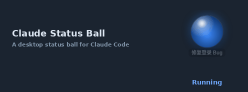
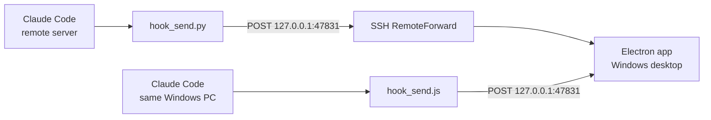
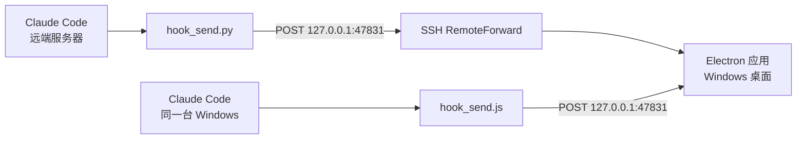

# Claude Status Ball / Claude 状态球

**English** | **[中文](#chinese)**

> **English:** A Windows desktop status ball for Claude Code sessions. It works with Claude Code on a remote Linux server over SSH and with Claude Code running natively on the same Windows PC—no tunnel required in local mode.

> **中文：** 把 Claude Code 会话状态投到 Windows 桌面——运行中蓝色呼吸，等待确认时琥珀色脉冲，任务完成变绿、抖动并弹出回复摘要。支持远端服务器（SSH 反向隧道）和 Windows 本机（无需隧道）两种接法。




<a name="english"></a>
## English

### Why

Claude Code often runs where you are not looking: in a long-running terminal session, or on a remote Linux box. The status ball makes session state visible at a glance:

- Blue breathing while Claude is working.
- Amber pulse when Claude needs permission or input.
- Green with a shake and a summary bubble when the turn is done.
- The ball disappears when the session ends.

This is **not an SSH-only tool**. Two setups are first-class:

- **Remote mode:** Claude Code runs on a Linux server; hooks send events through an SSH reverse tunnel to Windows.
- **Local mode:** Claude Code runs natively on the same Windows PC; hooks post directly to `127.0.0.1`. No SSH tunnel, no server-side Python, and no `~/.ssh/config` entry are needed.

The hooks, state machine, bubbles, tray behavior, and session labels are identical in both modes. Only the event path changes.

The ball can be dragged anywhere on the desktop (including secondary monitors) and its position is remembered across restarts.

### Features

- Works with both remote and local Claude Code sessions.
- One ball per Claude Code session, identified by `session_id`.
- Bubble shows the last assistant text from the session transcript.
- Ball label follows the session name: a `/rename` custom title wins over Claude Code's auto-generated title, and the project folder name is the final fallback.
- Click a done or waiting ball to re-open its bubble.
- Right-click a ball to show the bubble again or close that ball.
- Tray menu to simulate a completion, clear completed balls, or quit.
- Headless runs (`claude -p`, SDK calls) are ignored and never create balls.
- Everything stays local: remote events travel over an SSH tunnel; local events go directly over loopback. No third-party service is involved.

### Supported setups

| Setup | Where Claude Code runs | Event path | Extra requirements |
| --- | --- | --- | --- |
| **Remote mode** | Linux server | `hook_send.py` → SSH `RemoteForward` → app | `python3` on the server; OpenSSH on Windows with remote forwarding |
| **Local mode** | Same Windows PC | `hook_send.js` → `127.0.0.1:47831` → app | Node.js 18+ (already required by the app) |

Both modes use the same event schema and the same desktop app. You can switch modes without changing the app; only the hook configuration changes.

### How it works



| State | Look | Hook event |
| --- | --- | --- |
| Running | Blue, breathing | `UserPromptSubmit`, `PostToolUse` |
| Waiting | Amber, pulsing | `Notification` |
| Done | Green, shake + bubble | `Stop` |
| Ended | Ball removed | `SessionEnd` |

`PostToolUse` is throttled to one event every 8 seconds per session; it mainly restores the blue state after you approve a permission prompt.

### Requirements

- **Windows 10/11** with **Node.js 18+** (LTS recommended).
- **Local mode:** Claude Code running natively on the same Windows PC. No Python is required.
- **Remote mode:** a server running Claude Code and `python3`, plus **OpenSSH** on Windows with remote forwarding support.
- No admin rights are required for the app itself.

If Claude Code runs inside WSL, see [Claude Code runs inside WSL](#wsl-en) before choosing a mode.

### Install

#### Step 1: Install the Windows app (both modes)

Clone the repository on Windows, or download and extract the ZIP:

```powershell
git clone https://github.com/<your-username>/claude-status-ball.git C:\Tools\claude-status-ball
cd C:\Tools\claude-status-ball\app
npm install
```

Electron is about 100 MB. If the binary download fails, use a mirror:

```powershell
$env:ELECTRON_MIRROR="https://npmmirror.com/mirrors/electron/"
npm install
```

#### Step 2: Connect Claude Code to the app

Choose the option that matches where Claude Code runs.

##### Option A: Claude Code on a remote server (SSH tunnel)

Run the installer on the server that hosts Claude Code:

```bash
git clone https://github.com/<your-username>/claude-status-ball.git
cd claude-status-ball
bash remote/install_remote.sh
```

The installer:

- copies `hook_send.py` to `~/.claude-ball/hook_send.py`;
- backs up `~/.claude/settings.json` to `settings.json.bak.<timestamp>`;
- merges the five Claude Code hooks (idempotent, safe to re-run).

Restart any running Claude Code sessions afterward so they load the new hooks.

> The installer modifies your Claude Code settings. Review `remote/install_remote.sh` before running it if you prefer.

If you do not want to run the script, merge `remote/settings-hooks.snippet.json` into `~/.claude/settings.json` manually.

Then open the reverse tunnel on Windows. Edit `C:\Users\<your-name>\.ssh\config` (create it if needed) and add a block that matches the host you actually use:

```sshconfig
Host 1.2.3.4
    RemoteForward 47831 127.0.0.1:47831
```

If you connect as `ssh root@1.2.3.4`, `Host 1.2.3.4` is enough. If you use an alias such as `ssh myserver`, use `Host myserver` and add `HostName`/`User`. See `windows/ssh_config_example.txt`.

Important details:

- The file must be named `config`, **not** `config.txt`. Windows Explorer hides extensions by default.
- The `Host` value must match the hostname in your `ssh` command.
- Reconnect after editing. Existing sessions do not pick up config changes.
- Verify on Windows:

  ```powershell
  ssh -G root@1.2.3.4 | Select-String -Pattern remoteforward
  ```

  Expected output includes `remoteforward 47831 127.0.0.1:47831`.

- If you use WSL or Git Bash, `ssh` reads that environment's `~/.ssh/config`, not the Windows one.
- The listener exists only while an SSH connection carrying the forward is alive. The Electron app does **not** need to be running for the listener to exist, but it does need to be running for events to be accepted.
- Multiple simultaneous connections to the same server may print `remote port forwarding failed for listen port 47831`. This is harmless: the first connection already owns the port. Alternatively, keep one dedicated tunnel open:

  ```powershell
  ssh -N -R 47831:127.0.0.1:47831 root@1.2.3.4
  ```

##### Option B: Claude Code on the same Windows PC (no tunnel)

From the repository root on Windows:

```powershell
cd C:\Tools\claude-status-ball
node remote\install_local.js
```

The installer:

- copies `hook_send.js` to `%USERPROFILE%\.claude-ball\hook_send.js`;
- backs up `%USERPROFILE%\.claude\settings.json`;
- merges the same five hooks, using the absolute path of the Node.js executable that is running the installer;
- is idempotent: re-running it does not duplicate hooks.

Restart any running Claude Code sessions afterward. No SSH configuration, tunnel, or `config` file is used in this mode.

If Node.js is upgraded or moved later, run the installer again so the hook commands point at the new `node.exe`.

<a name="wsl-en"></a>
##### Claude Code runs inside WSL

Hooks execute inside the environment where Claude Code runs. Installing from Windows does not affect a Claude Code process inside WSL.

Two options:

1. Run Claude Code natively on Windows and use Option B.
2. Install the Python hook inside WSL (`bash remote/install_remote.sh` there) and make the Windows app's `127.0.0.1:47831` reachable from WSL. WSL networking varies by version and configuration, so this may require a tunnel or mirrored networking. Option A is the safer fallback.

#### Step 3: Start the app

Double-click `C:\Tools\claude-status-ball\app\start_ball.vbs`, or run with logs:

```powershell
cd C:\Tools\claude-status-ball\app
npm start
```

A small ball icon appears in the tray. The VBS launcher hides the console window.

To start it at login, create a shortcut to `start_ball.vbs` and put it in the Startup folder (`Win+R` → `shell:startup`).

#### Step 4: Verify

1. Right-click the tray icon → `测试：模拟一次任务完成` (simulate a completed task). A ball should pop up, turn green, shake, and show a bubble.
2. Send a test event from the environment where Claude Code runs.

   **Remote mode**, on the server:

   ```bash
   curl -sS -o /dev/null -w '%{http_code}\n' -X POST http://127.0.0.1:47831/event \
     -H 'Content-Type: application/json' \
     -d '{"session_id":"test1","event":"running","label":"Tunnel test"}'

   curl -sS -o /dev/null -w '%{http_code}\n' -X POST http://127.0.0.1:47831/event \
     -H 'Content-Type: application/json' \
     -d '{"session_id":"test1","event":"done","label":"Tunnel test","summary":"Tunnel works."}'
   ```

   Both should return `204`. The ball should turn blue, then green with a bubble.

   **Local mode**, in PowerShell:

   ```powershell
   '{"session_id":"test1","cwd":"C:/demo","transcript_path":""}' |
     node "$env:USERPROFILE\.claude-ball\hook_send.js" done
   ```

   A ball labeled `demo` should appear in the done state.

3. Start a **new** Claude Code session and ask it to do something. The ball should turn blue while it works, then green and shake when the turn ends.

### Configuration

- Hook target URL: `CLAUDE_BALL_URL`, default `http://127.0.0.1:47831/event`. Applies to both senders.
- Port `47831` is shared by the app, the SSH `RemoteForward` line (remote mode), and the hooks. Changing it requires updating all three.
- Ball position is stored in `%APPDATA%\claude-status-ball\position.json`. Delete that file to reset it to the primary display's bottom-right corner.
- Remote mode: hooks and script live in `~/.claude-ball/`; settings are in `~/.claude/settings.json`.
- Local mode: hooks and script live in `%USERPROFILE%\.claude-ball\`; settings are in `%USERPROFILE%\.claude\settings.json`.
- The local installer respects `CLAUDE_CONFIG_DIR` and writes `settings.json` there when it is set.
- The local installer embeds the current Node.js path in every hook command. Re-run it after changing Node versions.

### Troubleshooting

Not sure which mode you are using? If you never configured `RemoteForward` in `~/.ssh/config`, you are in local mode.

#### The ball stays amber

Claude is waiting for a permission decision. Approve or deny it; the next tool call turns the ball blue again.

#### The label shows a folder name or an old name

The session title has not been generated yet, or the installed hook predates custom-title support. Re-run the installer for your mode (`remote/install_remote.sh` on a server, `node remote/install_local.js` on Windows). The label prefers a `/rename` custom title, then Claude Code's auto-generated `ai-title`, then the project folder name.

#### Headless runs still show a ball

Update to the current version of the hook (re-run the installer for your mode). Headless sessions are detected via `CLAUDE_CODE_ENTRYPOINT` or the transcript's `entrypoint` field (`sdk-cli`, `sdk-ts`, `sdk-py`) and are skipped.

#### Local mode: hooks do not fire

- Hooks are loaded when a session starts. Restart the Claude Code session.
- Check that `%USERPROFILE%\.claude\settings.json` is valid JSON and contains commands with `claude-ball` (or use `%CLAUDE_CONFIG_DIR%\settings.json` if you set that variable).
- The hook command should start with the absolute path to `node.exe`. If Node was upgraded or moved, re-run `node remote\install_local.js`.
- Simulate an event directly:

  ```powershell
  '{"session_id":"manual","cwd":"C:/demo","transcript_path":""}' |
    node "$env:USERPROFILE\.claude-ball\hook_send.js" done
  ```

  A green `demo` ball means the sender works and the issue is hook registration. No ball means check that the app is running and `netstat -ano | findstr 47831` shows a listener.

#### Local mode: Node is not found

The installer writes the absolute path to the Node.js executable into every hook command, so `node` does not need to be on the PATH used by Claude Code. If you move or upgrade Node.js, re-run `node remote\install_local.js`.

#### WSL: no ball appears

Claude Code inside WSL does not use the Windows hook installation. Follow [Claude Code runs inside WSL](#wsl-en) and install the Python hook inside WSL, or run Claude Code natively on Windows.

#### Remote mode: `ss -ltn | grep 47831` shows nothing on the server

The SSH client did not request the forward. Check, in order:

1. The file is `%USERPROFILE%\.ssh\config`, not `config.txt`.
2. The `Host` block matches the exact hostname used in your `ssh` command.
3. You reconnected after editing the file.
4. `ssh -G <host> | findstr /i remoteforward` (cmd) shows the forward.
5. On the server, `sshd -T | grep -i allowtcpforwarding` returns `allowtcpforwarding yes`.

#### Remote mode: the listener exists, but `curl` returns an empty reply

The tunnel is working, but nothing is listening on the Windows side. Start the Electron app and check:

```powershell
netstat -ano | findstr 47831
```

You should see a listener owned by Electron or Node.

#### Remote mode: hooks do not fire

- Hooks are loaded when a session starts. Restart the Claude Code session.
- Check that `~/.claude/settings.json` is valid JSON and contains `claude-ball`.
- Simulate an event directly:

  ```bash
  echo '{"session_id":"manual","cwd":"/tmp/demo","transcript_path":""}' \
    | python3 ~/.claude-ball/hook_send.py done
  ```

#### The ball is in the wrong place or missing

The position is clamped to the current display layout. Delete `%APPDATA%\claude-status-ball\position.json` to reset it.

#### `npm install` fails while downloading Electron

Use the mirror shown in Step 1. Corporate proxies may also need `HTTPS_PROXY` set for npm.

### Security and privacy

- The Electron event server binds only to `127.0.0.1:47831`.
- Remote mode: events travel from the server to Windows through the SSH tunnel.
- Local mode: events never leave the machine.
- The hook reads the session transcript locally and sends only the short event payload (session id, state, label, and up to 600 characters of the last assistant reply).
- The local port has no authentication. Any local process or user on the machine could post fake events. Do not expose port 47831 beyond loopback.
- The installers back up `settings.json` before modifying it. Restore the backup to undo.

### Limitations

- The desktop app is Windows-only.
- Only Claude Code is supported. The claude.ai web and desktop chat apps do not expose local hook events.
- Local mode assumes Claude Code runs natively on Windows. WSL requires the Python hook plus additional networking.
- The app UI strings are currently in Chinese. Claude's reply summaries and session titles appear in whatever language you use with Claude.
- Desktop monitors cannot physically vibrate; the "vibration" is a shake animation.
- `PostToolUse` runs on every tool call (a few dozen milliseconds each) and is throttled to one event every 8 seconds.
- The app is not code-signed. If you later package it as an EXE, SmartScreen may warn you.

### Development

Run the tests from the repository root:

```bash
node test/smoke.js
node test/test_hook_js.js
node test/test_install.js
python3 test/test_hook.py
```

CI runs the Node tests on Ubuntu and Windows, and the Python hook test on Ubuntu.

Render the ball and bubble states to PNGs (Linux, requires Xvfb):

```bash
npm install --prefix app
BALL_SHOTS_DIR=/tmp/ball-shots xvfb-run -a \
  app/node_modules/.bin/electron --no-sandbox --disable-gpu test/visual_smoke.js
```

Project layout:

```
app/        Electron app (copy this folder to Windows)
  main.js       main process, windows, tray, drag and placement
  server.js     local HTTP event server
  state.js      session state reducer
  placement.js  multi-monitor geometry
  renderer/     ball and bubble UI
remote/     hook senders and installers
  hook_send.py      remote Linux sender (Python)
  hook_send.js      local Windows sender (Node)
  install_remote.sh remote Linux installer
  install_local.js  local Windows installer
windows/    SSH reverse-tunnel example (remote mode)
test/       Node and Python tests, visual smoke script
docs/       README media
```

### Uninstall

1. Remote mode: restore `~/.claude/settings.json.bak.*` or remove the hook entries containing `claude-ball`; then delete `~/.claude-ball/`.
2. Local mode: remove the hook entries containing `claude-ball` from `%USERPROFILE%\.claude\settings.json` (or restore the backup), then delete `%USERPROFILE%\.claude-ball\hook_send.js`.
3. Delete the app folder and the Startup shortcut.
4. Optionally delete `%APPDATA%\claude-status-ball\`.

### License

[MIT](LICENSE)

This is an unofficial community project. Claude and Claude Code are trademarks of Anthropic.

[中文](#chinese)

---

<a name="chinese"></a>
## 中文

[English](#english) | **中文**

### 为什么做这个

Claude Code 经常在你没盯着的地方运行：可能是一个跑很久的终端会话，也可能是远端 Linux 服务器。状态球把这些会话的状态变成桌面上可见的信号：

- 运行中：蓝色呼吸。
- 等待权限或输入：琥珀色脉冲。
- 任务完成：变绿、抖动，并弹出回复摘要。
- 会话结束：球自动消失。

这**不是一个只支持 SSH 的工具**。下面两种接法都是一等公民：

- **远端模式：** Claude Code 跑在 Linux 服务器上，hook 通过 SSH 反向隧道把事件送到 Windows。
- **本地模式：** Claude Code 直接跑在同一台 Windows 电脑上，hook 直接访问 `127.0.0.1`。不需要 SSH 隧道、不需要服务器端 Python，也不需要改 `~/.ssh/config`。

两种模式的 hook、状态机、气泡、托盘行为和会话名称完全一致，区别只在事件怎么到达桌面应用。

球可以拖到桌面任意位置（包括副屏），位置会在重启后保留。

### 功能

- 同时支持远端和本地 Claude Code 会话。
- 每个 Claude Code 会话一个球，用 `session_id` 区分。
- 气泡显示会话 transcript 里最后一条主线程助手回复。
- 球上的名称跟随会话名：`/rename` 的自定义标题优先于 Claude Code 自动生成的标题，最后回退到项目文件夹名。
- 点击完成或等待中的球，可以重新打开气泡。
- 右键球可以重新显示气泡，或关闭这个球。
- 托盘菜单支持模拟一次完成、清除已完成的球、退出。
- headless 运行（`claude -p`、SDK 调用）会被忽略，不会产生球。
- 所有数据都留在本地：远端模式走 SSH 隧道，本地模式只走 loopback，不经过第三方服务。

### 支持的两种接法

| 接法 | Claude Code 所在位置 | 事件路径 | 额外要求 |
| --- | --- | --- | --- |
| **远端模式** | Linux 服务器 | `hook_send.py` → SSH `RemoteForward` → 应用 | 服务器有 `python3`；Windows 的 OpenSSH 支持远端转发 |
| **本地模式** | 同一台 Windows 电脑 | `hook_send.js` → `127.0.0.1:47831` → 应用 | Node.js 18+（应用本身已经要求） |

两种模式使用同一套事件格式和同一个桌面应用。切换模式不需要改应用，只需要改 hook 配置。

### 工作原理



| 状态 | 表现 | 对应 hook |
| --- | --- | --- |
| 运行中 | 蓝色呼吸 | `UserPromptSubmit`、`PostToolUse` |
| 等待中 | 琥珀色脉冲 | `Notification` |
| 完成 | 绿色、抖动、弹出气泡 | `Stop` |
| 结束 | 移除球 | `SessionEnd` |

`PostToolUse` 每个会话最多每 8 秒发一次；它主要用于在你批准权限后，把球恢复成蓝色运行状态。

### 环境要求

- **Windows 10/11**，**Node.js 18+**（建议 LTS）。
- **本地模式：** Claude Code 原生运行在同一台 Windows 电脑上。不需要 Python。
- **远端模式：** 运行 Claude Code 的服务器需要 `python3`；Windows 需要支持远端转发的 **OpenSSH**。
- 应用本身不需要管理员权限。

如果 Claude Code 跑在 WSL 里，先看 [Claude Code 在 WSL 中运行](#wsl-zh) 再选择接法。

### 安装

#### 第 1 步：安装 Windows 应用（两种模式都一样）

在 Windows 上克隆仓库，或下载 ZIP 后解压：

```powershell
git clone https://github.com/<your-username>/claude-status-ball.git C:\Tools\claude-status-ball
cd C:\Tools\claude-status-ball\app
npm install
```

Electron 大约 100 MB。如果下载失败，可以使用镜像：

```powershell
$env:ELECTRON_MIRROR="https://npmmirror.com/mirrors/electron/"
npm install
```

#### 第 2 步：把 Claude Code 接到应用上

根据 Claude Code 实际运行的位置二选一。

##### 方案 A：Claude Code 在远端服务器上（SSH 隧道）

在运行 Claude Code 的服务器上执行安装器：

```bash
git clone https://github.com/<your-username>/claude-status-ball.git
cd claude-status-ball
bash remote/install_remote.sh
```

安装器会：

- 把 `hook_send.py` 复制到 `~/.claude-ball/hook_send.py`；
- 把 `~/.claude/settings.json` 备份为 `settings.json.bak.<时间戳>`；
- 合并五个 Claude Code hook（幂等，可以重复执行）。

安装完成后重启正在运行的 Claude Code 会话，让它们加载新 hook。

> 安装器会修改 Claude Code 设置。如果不放心，可以先阅读 `remote/install_remote.sh` 再执行。

如果不想运行脚本，也可以手动把 `remote/settings-hooks.snippet.json` 合并到 `~/.claude/settings.json`。

然后在 Windows 上打开反向隧道。编辑 `C:\Users\<你的用户名>\.ssh\config`（没有就新建），加入与实际连接方式匹配的配置：

```sshconfig
Host 1.2.3.4
    RemoteForward 47831 127.0.0.1:47831
```

如果你平时用 `ssh root@1.2.3.4`，写 `Host 1.2.3.4` 就够了。如果用别名 `ssh myserver`，则写 `Host myserver`，并补上 `HostName`/`User`。示例见 `windows/ssh_config_example.txt`。

重要细节：

- 文件名必须是 `config`，**不能是 `config.txt`**。Windows 资源管理器默认隐藏扩展名。
- `Host` 必须和 `ssh` 命令里的主机名一致。
- 改完配置要重新连接，已有 SSH 会话不会自动加载新配置。
- 在 Windows 上验证：

  ```powershell
  ssh -G root@1.2.3.4 | Select-String -Pattern remoteforward
  ```

  输出里应包含 `remoteforward 47831 127.0.0.1:47831`。

- 如果使用 WSL 或 Git Bash，`ssh` 读取的是那个环境里的 `~/.ssh/config`，不是 Windows 的配置。
- 只有承载转发的 SSH 连接还活着时，服务器上的监听端口才存在。Electron 应用不需要一直运行才能让监听存在，但必须有应用在运行，事件才会被接收。
- 同时开多个到同一服务器的 SSH 连接时，后连接的可能会打印 `remote port forwarding failed for listen port 47831`。这是正常的：端口已经被第一条连接占用。也可以专门保留一条隧道：

  ```powershell
  ssh -N -R 47831:127.0.0.1:47831 root@1.2.3.4
  ```

##### 方案 B：Claude Code 在同一台 Windows 电脑上（不需要隧道）

在 Windows 的仓库根目录执行：

```powershell
cd C:\Tools\claude-status-ball
node remote\install_local.js
```

安装器会：

- 把 `hook_send.js` 复制到 `%USERPROFILE%\.claude-ball\hook_send.js`；
- 备份 `%USERPROFILE%\.claude\settings.json`；
- 合并同样的五个 hook，命令里使用当前运行安装器的 Node.js 绝对路径；
- 幂等，重复执行不会产生重复 hook。

安装完成后重启正在运行的 Claude Code 会话。本地模式不需要 SSH 配置、隧道或 `config` 文件。

以后如果升级或移动了 Node.js，重新执行一次安装器，让 hook 命令指向新的 `node.exe`。

<a name="wsl-zh"></a>
##### Claude Code 在 WSL 中运行

Hook 在 Claude Code 进程所在的环境里执行。在 Windows 上安装 hook 不会影响 WSL 里的 Claude Code。

两种做法：

1. 在 Windows 上原生运行 Claude Code，使用方案 B。
2. 在 WSL 里安装 Python hook（在 WSL 里执行 `bash remote/install_remote.sh`），并让 WSL 能访问 Windows 应用的 `127.0.0.1:47831`。WSL 的网络模式随版本和配置不同，可能需要额外隧道或 mirrored networking；更稳妥的兜底是方案 A。

#### 第 3 步：启动应用

双击 `C:\Tools\claude-status-ball\app\start_ball.vbs`，或者用下面的命令启动并查看日志：

```powershell
cd C:\Tools\claude-status-ball\app
npm start
```

托盘里会出现一个小球图标。VBS 启动器会隐藏控制台窗口。

如果希望开机自启，给 `start_ball.vbs` 建一个快捷方式，放进启动目录（`Win+R` → `shell:startup`）。

#### 第 4 步：验证

1. 右键托盘图标 → `测试：模拟一次任务完成`。应该出现一个球，变绿、抖动并弹出气泡。
2. 从 Claude Code 所在的环境发一条测试事件。

   **远端模式**，在服务器上：

   ```bash
   curl -sS -o /dev/null -w '%{http_code}\n' -X POST http://127.0.0.1:47831/event \
     -H 'Content-Type: application/json' \
     -d '{"session_id":"test1","event":"running","label":"Tunnel test"}'

   curl -sS -o /dev/null -w '%{http_code}\n' -X POST http://127.0.0.1:47831/event \
     -H 'Content-Type: application/json' \
     -d '{"session_id":"test1","event":"done","label":"Tunnel test","summary":"Tunnel works."}'
   ```

   两条都应返回 `204`。球应先变蓝，再变绿并弹出气泡。

   **本地模式**，在 PowerShell 里：

   ```powershell
   '{"session_id":"test1","cwd":"C:/demo","transcript_path":""}' |
     node "$env:USERPROFILE\.claude-ball\hook_send.js" done
   ```

   应该出现一个名为 `demo`、处于完成状态的球。

3. 新开一个 Claude Code 会话，让它做点事情。工作时球应变蓝，回合结束时变绿并抖动。

### 配置

- Hook 目标地址：`CLAUDE_BALL_URL`，默认 `http://127.0.0.1:47831/event`。两种发送器都支持。
- 端口 `47831` 由应用、SSH `RemoteForward`（远端模式）和 hook 共用。改端口时三处都要改。
- 球的位置保存在 `%APPDATA%\claude-status-ball\position.json`。删除该文件可重置到主屏右下角。
- 远端模式：hook 和脚本在 `~/.claude-ball/`；设置在 `~/.claude/settings.json`。
- 本地模式：hook 和脚本在 `%USERPROFILE%\.claude-ball\`；设置在 `%USERPROFILE%\.claude\settings.json`。
- 本地安装器支持 `CLAUDE_CONFIG_DIR`；设置后会写入该目录下的 `settings.json`。
- 本地安装器会把当前 Node.js 路径写进每条 hook 命令。更换 Node 版本后要重新执行安装器。

### 故障排查

不确定自己用的是哪种模式？如果没有在 `~/.ssh/config` 里配置过 `RemoteForward`，那就是本地模式。

#### 球一直是琥珀色

Claude 正在等待权限决定。批准或拒绝后，下一次工具调用会把球恢复成蓝色。

#### 球上的名称是文件夹名或旧名字

会话标题还没生成，或者安装的 hook 版本早于 custom-title 支持。按你的模式重新执行安装器（服务器上 `remote/install_remote.sh`，Windows 上 `node remote/install_local.js`）。名称优先级是 `/rename` 自定义标题 → Claude Code 自动生成的 `ai-title` → 项目文件夹名。

#### headless 运行也出现了球

把 hook 更新到当前版本（按你的模式重新执行安装器）。headless 会话会通过 `CLAUDE_CODE_ENTRYPOINT` 或 transcript 里的 `entrypoint` 字段（`sdk-cli`、`sdk-ts`、`sdk-py`）识别并跳过。

#### 本地模式：hook 不触发

- Hook 在会话启动时加载，先重启 Claude Code 会话。
- 检查 `%USERPROFILE%\.claude\settings.json` 是否是合法 JSON，并且包含带 `claude-ball` 的命令（如果设置了 `CLAUDE_CONFIG_DIR`，检查 `%CLAUDE_CONFIG_DIR%\settings.json`）。
- Hook 命令应以 `node.exe` 的绝对路径开头。如果升级或移动过 Node，重新执行 `node remote\install_local.js`。
- 直接模拟一条事件：

  ```powershell
  '{"session_id":"manual","cwd":"C:/demo","transcript_path":""}' |
    node "$env:USERPROFILE\.claude-ball\hook_send.js" done
  ```

  如果出现绿色的 `demo` 球，说明发送器正常，问题在 hook 注册。如果没有球，检查应用是否运行，以及 `netstat -ano | findstr 47831` 是否有监听。

#### 本地模式：找不到 Node

安装器会把 Node.js 可执行文件的绝对路径写进每条 hook 命令，所以 Claude Code 的 PATH 里不需要有 `node`。如果移动或升级了 Node.js，重新执行 `node remote\install_local.js`。

#### WSL：没有出现球

WSL 里的 Claude Code 不会使用 Windows 上安装的 hook。按 [Claude Code 在 WSL 中运行](#wsl-zh) 在 WSL 内安装 Python hook，或者改在 Windows 上原生运行 Claude Code。

#### 远端模式：服务器上 `ss -ltn | grep 47831` 没东西

SSH 客户端没有请求转发。按顺序检查：

1. 文件是 `%USERPROFILE%\.ssh\config`，不是 `config.txt`。
2. `Host` 块和 `ssh` 命令里的主机名完全一致。
3. 改完配置后重新连接过。
4. 在 cmd 里执行 `ssh -G <host> | findstr /i remoteforward`，能看到转发。
5. 服务器上 `sshd -T | grep -i allowtcpforwarding` 返回 `allowtcpforwarding yes`。

#### 远端模式：监听存在，但 `curl` 返回空回复

隧道是通的，但 Windows 侧没有应用在监听。启动 Electron 应用并检查：

```powershell
netstat -ano | findstr 47831
```

应该能看到 Electron 或 Node 持有的监听。

#### 远端模式：hook 不触发

- Hook 在会话启动时加载，先重启 Claude Code 会话。
- 检查 `~/.claude/settings.json` 是否是合法 JSON，并且包含 `claude-ball`。
- 直接模拟一条事件：

  ```bash
  echo '{"session_id":"manual","cwd":"/tmp/demo","transcript_path":""}' \
    | python3 ~/.claude-ball/hook_send.py done
  ```

#### 球的位置不对或不见了

位置会被限制在当前显示器布局内。删除 `%APPDATA%\claude-status-ball\position.json` 可重置。

#### `npm install` 下载 Electron 失败

使用第 1 步里的镜像。公司代理可能还需要给 npm 设置 `HTTPS_PROXY`。

### 安全与隐私

- Electron 事件服务器只绑定 `127.0.0.1:47831`。
- 远端模式：事件通过 SSH 隧道从服务器传到 Windows。
- 本地模式：事件不离开本机。
- Hook 在本地读取会话 transcript，只发送很短的事件载荷（会话 id、状态、名称，以及最多 600 字符的最后一条助手回复）。
- 本地端口没有认证。本机上的任意进程或用户都可以伪造事件。不要把 47831 暴露到 loopback 之外。
- 安装器在修改设置前会备份 `settings.json`。恢复备份即可撤销。

### 限制

- 桌面应用只支持 Windows。
- 只支持 Claude Code。claude.ai 网页版和桌面聊天版不提供本地 hook 事件。
- 本地模式假设 Claude Code 原生运行在 Windows 上。WSL 需要 Python hook 和额外网络配置。
- 应用 UI 文案目前是中文；Claude 的回复摘要和会话标题会跟随你与 Claude 使用的语言。
- 显示器不能真的震动，“震动”是抖动动画。
- `PostToolUse` 每次工具调用都会执行（几十毫秒），但每个会话每 8 秒最多发一次事件。
- 应用没有代码签名。以后打包成 EXE 时，SmartScreen 可能会警告。

### 开发

在仓库根目录运行测试：

```bash
node test/smoke.js
node test/test_hook_js.js
node test/test_install.js
python3 test/test_hook.py
```

CI 会在 Ubuntu 和 Windows 上运行 Node 测试，并在 Ubuntu 上运行 Python hook 测试。

把球和气泡渲染成 PNG（Linux，需要 Xvfb）：

```bash
npm install --prefix app
BALL_SHOTS_DIR=/tmp/ball-shots xvfb-run -a \
  app/node_modules/.bin/electron --no-sandbox --disable-gpu test/visual_smoke.js
```

目录结构：

```
app/        Electron 应用（复制这个目录到 Windows）
  main.js       主进程、窗口、托盘、拖拽和布局
  server.js     本地 HTTP 事件服务器
  state.js      会话状态 reducer
  placement.js  多显示器几何计算
  renderer/     球和气泡 UI
remote/     hook 发送器和安装器
  hook_send.py      远端 Linux 发送器（Python）
  hook_send.js      本地 Windows 发送器（Node）
  install_remote.sh 远端 Linux 安装器
  install_local.js  本地 Windows 安装器
windows/    SSH 反向隧道示例（远端模式）
test/       Node/Python 测试和视觉冒烟脚本
docs/       README 媒体文件
```

### 卸载

1. 远端模式：恢复 `~/.claude/settings.json.bak.*`，或删除包含 `claude-ball` 的 hook 条目；然后删除 `~/.claude-ball/`。
2. 本地模式：从 `%USERPROFILE%\.claude\settings.json` 删除包含 `claude-ball` 的 hook 条目（或恢复备份），然后删除 `%USERPROFILE%\.claude-ball\hook_send.js`。
3. 删除应用目录和启动目录里的快捷方式。
4. 可选：删除 `%APPDATA%\claude-status-ball\`。

### 许可证

[MIT](LICENSE)

这是一个非官方社区项目。Claude 和 Claude Code 是 Anthropic 的商标。
