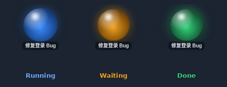
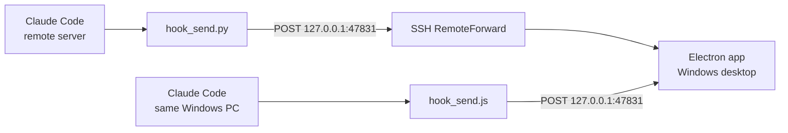

# Claude Status Ball

A Windows desktop status ball for [Claude Code](https://claude.com/claude-code) sessions.

> 中文简介：把 Claude Code 会话的状态投到 Windows 桌面上——运行中蓝色呼吸，等你确认时琥珀色脉冲，任务完成变绿、抖动并弹出回复摘要。支持远端服务器（SSH 反向隧道）和 Windows 本机两种接法。




## Why

Claude Code often runs in a terminal where a long task is easy to miss. This widget gives every session its own ball on the desktop:

- Blue breathing while Claude is working.
- Amber pulse when Claude needs permission or input.
- Green with a shake and a summary bubble when the turn is done.
- The ball disappears when the session ends.

The ball can be dragged anywhere on the desktop (including secondary monitors) and its position is remembered across restarts.

It works in two setups:

- **Remote:** Claude Code runs on a Linux server; hooks send events through an SSH reverse tunnel to Windows.
- **Local:** Claude Code runs on the same Windows PC; hooks post directly to `127.0.0.1`. No SSH tunnel or server-side Python is needed.

## Features

- One ball per Claude Code session, identified by `session_id`.
- Bubble shows the last assistant text from the session transcript.
- Ball label follows the session name: a `/rename` custom title wins over Claude Code's auto-generated title, and the project folder name is the final fallback.
- Click a done or waiting ball to re-open its bubble.
- Right-click a ball to show the bubble again or close that ball.
- Tray menu to simulate a completion, clear completed balls, or quit.
- Headless runs (`claude -p`, SDK calls) are ignored and never create balls.
- Everything stays local: remote events travel over an SSH tunnel; local events go directly over loopback. No third-party service is involved.

## How it works



| State | Look | Hook event |
| --- | --- | --- |
| Running | Blue, breathing | `UserPromptSubmit`, `PostToolUse` |
| Waiting | Amber, pulsing | `Notification` |
| Done | Green, shake + bubble | `Stop` |
| Ended | Ball removed | `SessionEnd` |

`PostToolUse` is throttled to one event every 8 seconds per session; it mainly restores the blue state after you approve a permission prompt.

## Requirements

- **Windows 10/11** with **Node.js 18+** (LTS recommended).
- **Local mode:** Claude Code running natively on the same Windows PC. No Python is required.
- **Remote mode:** a server running Claude Code and `python3`, plus **OpenSSH** on Windows with remote forwarding support.
- No admin rights are required for the app itself.

If Claude Code runs inside WSL, see [WSL](#claude-code-runs-inside-wsl) before choosing a mode.

## Install

### Step 1: Install the Windows app (both modes)

Clone the repository on Windows, or download and extract the ZIP:

```powershell
git clone https://github.com/<your-username>/claude-status-ball.git C:\Tools\claude-status-ball
cd C:\Tools\claude-status-ball\app
npm install
```

Electron is about 100 MB. If the binary download fails, use a mirror:

```powershell
$env:ELECTRON_MIRROR="https://npmmirror.com/mirrors/electron/"
npm install
```

### Step 2: Connect Claude Code to the app

Choose the option that matches where Claude Code runs.

#### Option A: Claude Code on a remote server (SSH tunnel)

Run the installer on the server that hosts Claude Code:

```bash
git clone https://github.com/<your-username>/claude-status-ball.git
cd claude-status-ball
bash remote/install_remote.sh
```

The installer:

- copies `hook_send.py` to `~/.claude-ball/hook_send.py`;
- backs up `~/.claude/settings.json` to `settings.json.bak.<timestamp>`;
- merges the five Claude Code hooks (idempotent, safe to re-run).

Restart any running Claude Code sessions afterward so they load the new hooks.

> The installer modifies your Claude Code settings. Review `remote/install_remote.sh` before running it if you prefer.

If you do not want to run the script, merge `remote/settings-hooks.snippet.json` into `~/.claude/settings.json` manually.

Then open the reverse tunnel on Windows. Edit `C:\Users\<your-name>\.ssh\config` (create it if needed) and add a block that matches the host you actually use:

```sshconfig
Host 1.2.3.4
    RemoteForward 47831 127.0.0.1:47831
```

If you connect as `ssh root@1.2.3.4`, `Host 1.2.3.4` is enough. If you use an alias such as `ssh myserver`, use `Host myserver` and add `HostName`/`User`. See `windows/ssh_config_example.txt`.

Important details:

- The file must be named `config`, **not** `config.txt`. Windows Explorer hides extensions by default.
- The `Host` value must match the hostname in your `ssh` command.
- Reconnect after editing. Existing sessions do not pick up config changes.
- Verify on Windows:

  ```powershell
  ssh -G root@1.2.3.4 | Select-String -Pattern remoteforward
  ```

  Expected output includes `remoteforward 47831 127.0.0.1:47831`.

- If you use WSL or Git Bash, `ssh` reads that environment's `~/.ssh/config`, not the Windows one.
- The listener exists only while an SSH connection carrying the forward is alive. The Electron app does **not** need to be running for the listener to exist, but it does need to be running for events to be accepted.
- Multiple simultaneous connections to the same server may print `remote port forwarding failed for listen port 47831`. This is harmless: the first connection already owns the port. Alternatively, keep one dedicated tunnel open:

  ```powershell
  ssh -N -R 47831:127.0.0.1:47831 root@1.2.3.4
  ```

#### Option B: Claude Code on the same Windows PC (no tunnel)

From the repository root on Windows:

```powershell
cd C:\Tools\claude-status-ball
node remote\install_local.js
```

The installer:

- copies `hook_send.js` to `%USERPROFILE%\.claude-ball\hook_send.js`;
- backs up `%USERPROFILE%\.claude\settings.json`;
- merges the same five hooks, using the absolute path of the Node.js executable that is running the installer;
- is idempotent: re-running it does not duplicate hooks.

Restart any running Claude Code sessions afterward. No SSH configuration, tunnel, or `config` file is used in this mode.

If Node.js is upgraded or moved later, run the installer again so the hook commands point at the new `node.exe`.

#### Claude Code runs inside WSL

Hooks execute inside the environment where Claude Code runs. Installing from Windows does not affect a Claude Code process inside WSL.

Two options:

1. Run Claude Code natively on Windows and use Option B.
2. Install the Python hook inside WSL (`bash remote/install_remote.sh` there) and make the Windows app's `127.0.0.1:47831` reachable from WSL. WSL networking varies by version and configuration, so this may require a tunnel or mirrored networking. Option A is the safer fallback.

### Step 3: Start the app

Double-click `C:\Tools\claude-status-ball\app\start_ball.vbs`, or run with logs:

```powershell
cd C:\Tools\claude-status-ball\app
npm start
```

A small ball icon appears in the tray. The VBS launcher hides the console window.

To start it at login, create a shortcut to `start_ball.vbs` and put it in the Startup folder (`Win+R` → `shell:startup`).

### Step 4: Verify

1. Right-click the tray icon → `测试：模拟一次任务完成` (simulate a completed task). A ball should pop up, turn green, shake, and show a bubble.
2. Send a test event from the environment where Claude Code runs.

   **Remote mode**, on the server:

   ```bash
   curl -sS -o /dev/null -w '%{http_code}\n' -X POST http://127.0.0.1:47831/event \
     -H 'Content-Type: application/json' \
     -d '{"session_id":"test1","event":"running","label":"Tunnel test"}'

   curl -sS -o /dev/null -w '%{http_code}\n' -X POST http://127.0.0.1:47831/event \
     -H 'Content-Type: application/json' \
     -d '{"session_id":"test1","event":"done","label":"Tunnel test","summary":"Tunnel works."}'
   ```

   Both should return `204`. The ball should turn blue, then green with a bubble.

   **Local mode**, in PowerShell:

   ```powershell
   '{"session_id":"test1","cwd":"C:/demo","transcript_path":""}' |
     node "$env:USERPROFILE\.claude-ball\hook_send.js" done
   ```

   A ball labeled `demo` should appear in the done state.

3. Start a **new** Claude Code session and ask it to do something. The ball should turn blue while it works, then green and shake when the turn ends.

## Configuration

- Hook target URL: `CLAUDE_BALL_URL`, default `http://127.0.0.1:47831/event`. Applies to both senders.
- Port `47831` is shared by the app, the SSH `RemoteForward` line (remote mode), and the hooks. Changing it requires updating all three.
- Ball position is stored in `%APPDATA%\claude-status-ball\position.json`. Delete that file to reset it to the primary display's bottom-right corner.
- Remote hooks and script live in `~/.claude-ball/`; settings are in `~/.claude/settings.json`.
- Local hooks and script live in `%USERPROFILE%\.claude-ball\`; settings are in `%USERPROFILE%\.claude\settings.json`.
- The local installer respects `CLAUDE_CONFIG_DIR` and writes `settings.json` there when it is set.
- The local installer embeds the current Node.js path in every hook command. Re-run it after changing Node versions.

## Troubleshooting

### The ball stays amber

Claude is waiting for a permission decision. Approve or deny it; the next tool call turns the ball blue again.

### The label shows a folder name or an old name

The session title has not been generated yet, or the installed hook predates custom-title support. Re-run the installer for your mode (`remote/install_remote.sh` on a server, `node remote/install_local.js` on Windows). The label prefers a `/rename` custom title, then Claude Code's auto-generated `ai-title`, then the project folder name.

### Headless runs still show a ball

Update to the current version of the hook (re-run the installer for your mode). Headless sessions are detected via `CLAUDE_CODE_ENTRYPOINT` or the transcript's `entrypoint` field (`sdk-cli`, `sdk-ts`, `sdk-py`) and are skipped.

### Local Windows hooks do not fire

- Hooks are loaded when a session starts. Restart the Claude Code session.
- Check that `%USERPROFILE%\.claude\settings.json` is valid JSON and contains commands with `claude-ball` (or use `%CLAUDE_CONFIG_DIR%\settings.json` if you set that variable).
- The hook command should start with the absolute path to `node.exe`. If Node was upgraded or moved, re-run `node remote\install_local.js`.
- Simulate an event directly:

  ```powershell
  '{"session_id":"manual","cwd":"C:/demo","transcript_path":""}' |
    node "$env:USERPROFILE\.claude-ball\hook_send.js" done
  ```

  A green `demo` ball means the sender works and the issue is hook registration. No ball means check that the app is running and `netstat -ano | findstr 47831` shows a listener.

### `ss -ltn | grep 47831` shows nothing on the server

The SSH client did not request the forward. Check, in order:

1. The file is `%USERPROFILE%\.ssh\config`, not `config.txt`.
2. The `Host` block matches the exact hostname used in your `ssh` command.
3. You reconnected after editing the file.
4. `ssh -G <host> | findstr /i remoteforward` (cmd) shows the forward.
5. On the server, `sshd -T | grep -i allowtcpforwarding` returns `allowtcpforwarding yes`.

### The listener exists, but `curl` returns an empty reply

The tunnel is working, but nothing is listening on the Windows side. Start the Electron app and check:

```powershell
netstat -ano | findstr 47831
```

You should see a listener owned by Electron or Node.

### Hooks do not fire (remote mode)

- Hooks are loaded when a session starts. Restart the Claude Code session.
- Check that `~/.claude/settings.json` is valid JSON and contains `claude-ball`.
- Simulate an event directly:

  ```bash
  echo '{"session_id":"manual","cwd":"/tmp/demo","transcript_path":""}' \
    | python3 ~/.claude-ball/hook_send.py done
  ```

### The ball is in the wrong place or missing

The position is clamped to the current display layout. Delete `%APPDATA%\claude-status-ball\position.json` to reset it.

### `npm install` fails while downloading Electron

Use the mirror shown in Step 1. Corporate proxies may also need `HTTPS_PROXY` set for npm.

## Security and privacy

- The Electron event server binds only to `127.0.0.1:47831`.
- Remote mode: events travel from the server to Windows through the SSH tunnel.
- Local mode: events never leave the machine.
- The hook reads the session transcript locally and sends only the short event payload (session id, state, label, and up to 600 characters of the last assistant reply).
- The local port has no authentication. Any local process or user on the machine could post fake events. Do not expose port 47831 beyond loopback.
- The installers back up `settings.json` before modifying it. Restore the backup to undo.

## Limitations

- The desktop app is Windows-only.
- Only Claude Code is supported. The claude.ai web and desktop chat apps do not expose local hook events.
- Local mode assumes Claude Code runs natively on Windows. WSL requires the Python hook plus additional networking.
- The app UI strings are currently in Chinese. Claude's reply summaries and session titles appear in whatever language you use with Claude.
- Desktop monitors cannot physically vibrate; the "vibration" is a shake animation.
- `PostToolUse` runs on every tool call (a few dozen milliseconds each) and is throttled to one event every 8 seconds.
- The app is not code-signed. If you later package it as an EXE, SmartScreen may warn you.

## Development

Run the tests from the repository root:

```bash
node test/smoke.js
node test/test_hook_js.js
node test/test_install.js
python3 test/test_hook.py
```

CI runs the Node tests on Ubuntu and Windows, and the Python hook test on Ubuntu.

Render the ball and bubble states to PNGs (Linux, requires Xvfb):

```bash
npm install --prefix app
BALL_SHOTS_DIR=/tmp/ball-shots xvfb-run -a \
  app/node_modules/.bin/electron --no-sandbox --disable-gpu test/visual_smoke.js
```

Project layout:

```
app/        Electron app (copy this folder to Windows)
  main.js       main process, windows, tray, drag and placement
  server.js     local HTTP event server
  state.js      session state reducer
  placement.js  multi-monitor geometry
  renderer/     ball and bubble UI
remote/     hook senders and installers
  hook_send.py      remote Linux sender (Python)
  hook_send.js      local Windows sender (Node)
  install_remote.sh remote Linux installer
  install_local.js  local Windows installer
windows/    SSH reverse-tunnel example (remote mode)
test/       Node and Python tests, visual smoke script
docs/       README media
```

## Uninstall

1. Remote mode: restore `~/.claude/settings.json.bak.*` or remove the hook entries containing `claude-ball`; then delete `~/.claude-ball/`.
2. Local mode: remove the hook entries containing `claude-ball` from `%USERPROFILE%\.claude\settings.json` (or restore the backup), then delete `%USERPROFILE%\.claude-ball\hook_send.js`.
3. Delete the app folder and the Startup shortcut.
4. Optionally delete `%APPDATA%\claude-status-ball\`.

## License

[MIT](LICENSE)

This is an unofficial community project. Claude and Claude Code are trademarks of Anthropic.
